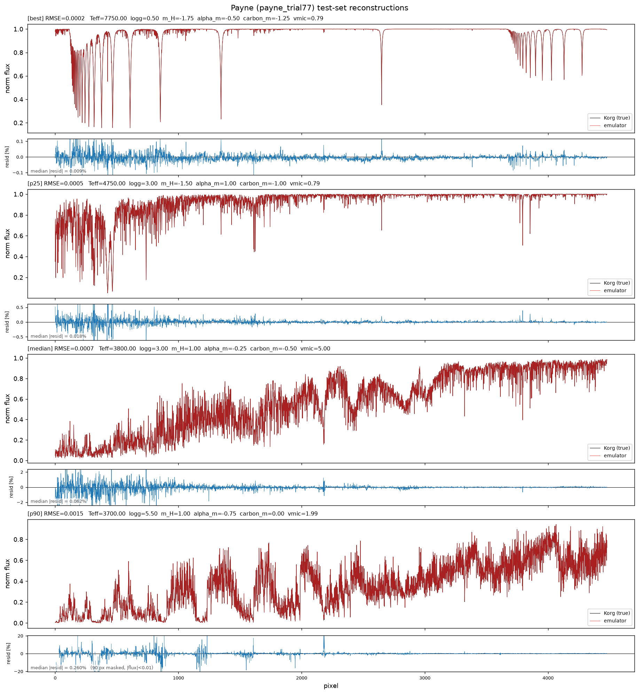
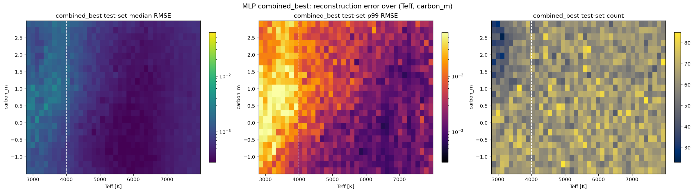
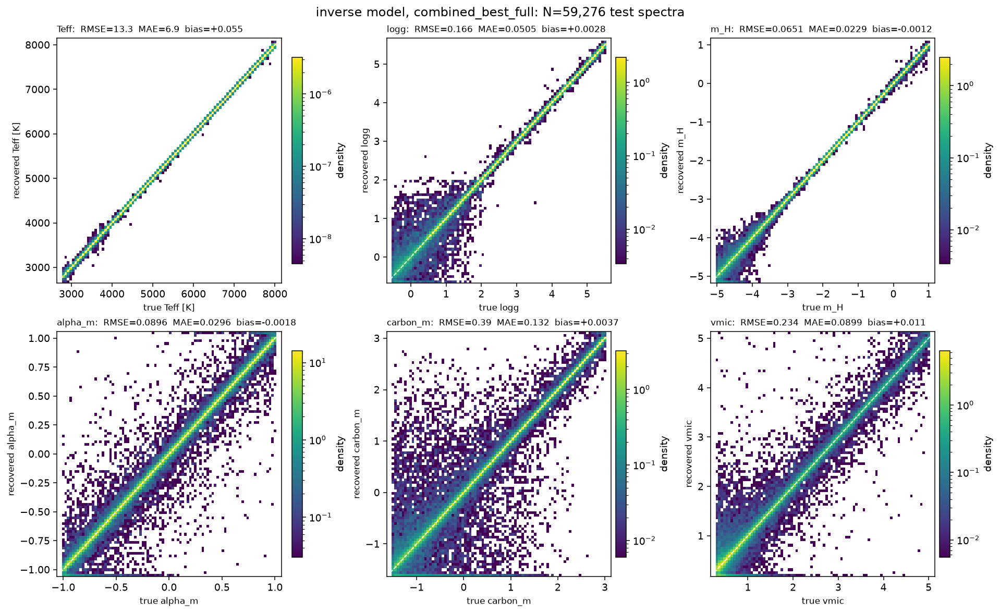
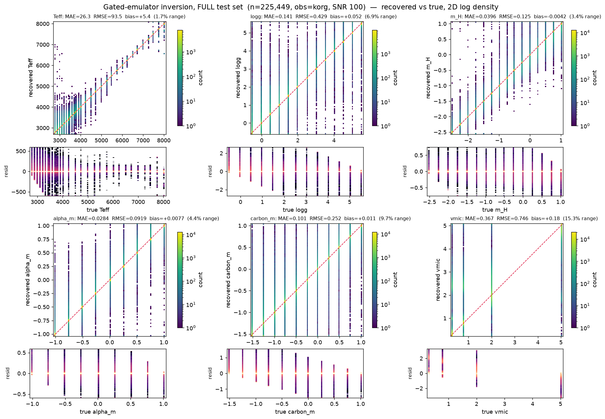

# BOSS emulator

A fast, differentiable neural emulator for BOSS stellar spectra. It maps a
handful of stellar **labels → a continuum-normalised spectrum** (4479 pixels),
reproducing what the [Korg](https://github.com/ajwheeler/Korg.jl)
radiative-transfer code synthesises, but in milliseconds instead of
CPU-minutes. Because the network is a JAX model it is differentiable in its
inputs, so it can also be run *backwards* — recovering labels from an observed
spectrum by gradient-based optimisation or MCMC (see
[`script/inv_model/`](script/inv_model/README.md)).

---

## What it learns

Two Korg grids are supported. The results in this section and the next are for
the original **factorial grid** of **2,254,492 converged spectra** on a regular
lattice of six core stellar labels; the newer random-sampled
**BOSS-Grid-Combined** is covered in [its own section](#the-boss-grid-combined-grid).

| label | meaning | grid |
|---|---|---|
| `Teff` | effective temperature | 2800–8000 K (30 steps) |
| `logg` | surface gravity | −0.5 … 5.5 (13) |
| `m_H` | metallicity [M/H] | −2.5 … 1.0 (15) |
| `alpha_m` | alpha enhancement | −1.0 … 1.0 (9) |
| `carbon_m` | carbon enhancement | −1.5 … 1.0 (11) |
| `vmic` | microturbulence | 4 values, 0.3–5.0 |

Each spectrum is 4479 pixels (trimmed from 4648). The grid also carries 21
individual element abundances, but in this grid they are an **exact affine
function** of `(m_H, alpha_m, carbon_m)`, so they add no degrees of freedom —
the emulator is trained **abundance-free on the six core labels** with no loss
of accuracy, which also removes a nasty input degeneracy for inverse modelling.

## The model & the headline result

The emulator is a plain **MLP** ([`src/boss_emulator/emulator.py`](src/boss_emulator/emulator.py)):
a dense network mapping labels → all pixels in one shot, with optional residual
connections and pre-activation LayerNorm.

Three fancier architectures were evaluated and dropped — a DeepONet (learned
basis × coefficients), a Perceiver-style cross-attention decoder, and a
coordinate/INR network. For this data-rich, low-input-dimension regression the
plain MLP won **decisively** (~38× lower error than the DeepONet): the fancier
decoders impose inductive biases that only bottleneck capacity here.

After an Optuna hyper-parameter search the best architecture is an **8×1281 SiLU
MLP**. The HPO winner (1000 epochs) was not overfitting — train and validation
loss were equal and still falling — so the same configuration was retrained
from scratch for 3000 epochs on a single cosine schedule:

| metric (held-out test set, 225k spectra) | HPO winner, 1000 ep | **3000 ep from scratch** |
|---|---|---|
| R² | 0.99996 | 0.99998 |
| per-spectrum median RMSE (norm. flux) | 7.2 × 10⁻⁴ | **5.8 × 10⁻⁴** |
| per-spectrum p99 RMSE | 3.3 × 10⁻³ | **2.3 × 10⁻³** |
| standardised RMSE | 6.6 × 10⁻³ | 5.4 × 10⁻³ |

The longer run cuts the median by 18% and the p99 tail by 28%; the loss was
flattening by epoch ~2800, so 3000 is close to the sweet spot for this size.

Emulated vs. Korg spectra spanning the error range (best → p90), with the
percentage residual under each panel:



### Cool-star specialist + gate

Residual error concentrates in cool, carbon-rich, high-microturbulence stars
(deep molecular bands). A **specialist** MLP trained only on the cool region is
blended onto the generalist by a **smooth gate on `Teff`**
(`w·specialist + (1−w)·generalist`), cutting cool-region error ~12–13% at
**zero cost to hot stars** and keeping the emulator continuous in parameter
space. The remaining extreme outliers are an *under-resolved-grid* effect (the
spectrum varies faster than the grid samples it at a molecular-band cliff), not
a model limitation — they would only shrink with denser Korg sampling there.

The 3000-epoch generalist above beats the gated pair on every metric as a
single model, so the gate is now optional.

### Loss weighting: spectra vs. wavelengths

`script/exp_reweight.py` tests residual-based re-weighting of the loss on top
of the 3000-epoch model (300 fine-tuning epochs per arm, against a plain-MSE
control that isolates what the weights add).

*Per-spectrum* weights (up-weight the stars the model gets wrong) only
redistribute a fixed capacity budget: the tail improves, the bulk pays. Not
worth it.

*Per-wavelength* weights are a different story. The aggregate flux residual is
nearly flat in wavelength (max/median ≈ 2.7 across pixels), but the
standardised target `(f − μ_λ)/σ_λ` is itself a hidden wavelength weighting:
`1/σ_λ²` spans a factor ~200 and over-spends on low-variance red pixels whose
flux error is already the smallest. Training the last 300 epochs in **flux
units** (weights `σ_λ²`, i.e. the metric we actually report) is the best arm on
every metric:

| arm (300 ep on the 3000-ep model) | median | p90 | p99 | cool (Teff ≤ 4000) median |
|---|---|---|---|---|
| control (plain standardised MSE) | 5.79e-4 | 1.14e-3 | 2.31e-3 | 7.22e-4 |
| per-pixel residual weights | 5.68e-4 | 1.12e-3 | 2.30e-3 | 7.10e-4 |
| per-(Teff node, pixel) residual weights | 5.66e-4 | 1.13e-3 | 2.32e-3 | 7.22e-4 |
| **flux-unit loss** | **5.59e-4** | **1.11e-3** | **2.27e-3** | **7.00e-4** |

The flux-unit loss gives up 2–10% on the low-variance red pixels and gains
5–15% at the blue molecular band heads and strong lines. Per-pixel residual
weights give a consistent ~2% with nothing getting worse; conditioning them on
Teff adds nothing. The obvious next step, not yet run, is a full 3000-epoch
from-scratch training with the flux-unit loss.

---

## The BOSS-Grid-Combined grid

The second grid (SDSS `boss_korg_grid/BOSS-Grid-Combined`, Sept 2026) is
**650,000 spectra at random points** of the same six-label box (runs
`BOSS-Grid-Random` + `BOSS-Grid-Random-TopUp`), 592,762 of them converged. Same
pixel layout as the factorial grid, so the loader is unchanged; point
`BOSS_RAW_PATH` at its `korg_grid.h5` and `BOSS_CACHE_DIR` at an empty
directory to build its cache. Every label is now continuous — including
`vmic`, which had only four values before — so the discrete-`vmic` inversion
tricks are moot, and the held-out test set is genuinely off-lattice.

**One data bug to know about.** Raw row 165845 is flagged converged but its
flux is the unconverged fill value −1.0 throughout. Trained on, it punches a
hole in the emulator (predicted flux ≈ −0.6 over a whole neighbourhood of an
ordinary G dwarf). `build_cache` now drops rows with non-finite or negative flux
and records them in the cache attributes.

### Forward model

The factorial-grid recipe (8×1281 SiLU, 3000 epochs) is a poor fit here: with
four times fewer rows it over-fits by 13× in train/val loss. A fresh Optuna
search (`trained_model/combined_hpo`, 79 trials × 1000 epochs, with a new
divergence guard in the training loop because the median pruner never cut runs
that blew up after a good start) converged on **plain GELU MLPs, 4–6 layers,
width ≈ 3000, dropout < 0.01, learning rate 1.4–3.3 × 10⁻⁴, batch 4096**.
LayerNorm and residual connections lost every time, dropout above 0.03 and
learning rates above 10⁻³ were fatal, and width mattered more than depth.

| model (test set, 59k off-lattice spectra) | median | p90 | p99 | max |
|---|---|---|---|---|
| 8×1281 SiLU, 3000 ep (old recipe, uncleaned cache) | 7.3 × 10⁻⁴ | 2.5 × 10⁻³ | 1.8 × 10⁻² | 1.56 |
| HPO winner 5×3238 GELU, 1000 ep | 7.1 × 10⁻⁴ | | | |
| **HPO winner, 3000 ep, cleaned cache** | **5.3 × 10⁻⁴** | **2.3 × 10⁻³** | 1.8 × 10⁻² | 0.18 |

The median is now below the factorial grid's best model, on a harder test set.
The **tail did not move**, and it is concentrated: cool giants
(`Teff ≤ 4000 K, logg ≤ 1`) are 4% of the test set but carry 58% of the total
squared error, with a median of 3.9 × 10⁻³.



Two experiments show that this tail is a **data limit, not a modelling one**:

* The cool-star specialist + gate that gave −13% on the factorial grid gives
  −1 to −3% here, with or without up-weighting the giants
  (`script/run_specialist_combined.sh`). The generalist already fits its
  training set 27× better than validation, so more epochs on a subset have
  nothing left to learn.
* Networks trained **from scratch on the pathological region only**
  (`script/run_region_test.sh`, `script/make_region_cache.py`) are *worse* than
  the generalist on that same region — 2.6 × 10⁻³ vs 2.2 × 10⁻³ on
  `Teff ≤ 4000, logg ≤ 2`, and 4.3 × 10⁻³ vs 3.8 × 10⁻³ on `logg ≤ 1` — with
  validation loss flat from epoch 500 while training loss keeps falling, and a
  smaller network is worse still. The generalist wins only by transfer from
  neighbouring stars; 40k samples in the corner are not enough to learn the
  mapping directly. Only denser Korg sampling of cool giants will move it.

### Inverse model

Gradient-descent inversion warm-started by an amortized inverse net, on all
59,276 held-out Korg spectra at SNR 100 (`script/inv_model/plot_inverse_eval.py`
makes the figures):

| label | MAE | median abs. error | RMSE |
|---|---|---|---|
| `Teff` [K] | 6.9 | 4.3 | 13 |
| `logg` | 0.051 | 0.012 | 0.17 |
| `m_H` | 0.023 | 0.008 | 0.065 |
| `alpha_m` | 0.030 | 0.008 | 0.090 |
| `carbon_m` | 0.13 | 0.013 | 0.39 |
| `vmic` | 0.090 | 0.025 | 0.23 |

Median χ²/pixel is 1.00 and every bias is zero. This is 2–3× better than the
factorial grid at the same SNR (Teff ~20 K, [M/H] ~0.03 dex), because the
continuous sampling makes the inverse net a far better warm start than the
lattice allowed. `carbon_m` and `vmic` still pin to their lower bound for hot
stars where the spectrum carries no signal.



The whole chain — forward training, evaluation, inverse nets, inversions — is
one resumable script, `script/run_combined.sh`, parameterised by environment
variables (cache, output dirs, architecture and optimiser settings).

---

## Install

Requires Python ≥ 3.11 and [JAX](https://docs.jax.dev/en/latest/installation.html)
(install the CUDA build for GPU, the CPU build otherwise).

```bash
pip install -e .          # or: uv sync
```

**GPU selection.** On import the training/predict modules call
[`autocvd`](https://pypi.org/project/autocvd/) to pick a free GPU automatically.
Override it by setting `CUDA_VISIBLE_DEVICES=<id>` to pin a device, or
`JAX_PLATFORMS=cpu` to run on CPU (both also skip the auto-selection).

**Data.** The preprocessed cache (`korg_grid_train.h5`) is built on first use
from the raw Korg grid. Point at a prebuilt cache without copying via an
environment variable:

```bash
export BOSS_CACHE_DIR=/path/to/preprocessed_data     # dir holding the .h5 + sidecars
# or BOSS_CACHE_PATH=/path/to/korg_grid_train.h5     # the file itself
export BOSS_RAW_PATH=/path/to/korg_grid.h5           # raw grid to build a cache from
```

> **Data access.** The underlying BOSS spectra and the Korg synthesis grid are
> **not public**. They are available to members of the SDSS collaboration via
> the SDSS data access pages ([www.sdss.org](https://www.sdss.org)); a valid
> SDSS collaboration login is required to download them.

## Quickstart

Load a trained checkpoint and predict a spectrum from stellar labels:

```python
import numpy as np
from boss_emulator.emulator import load_checkpoint, predict_spectra

model, payload = load_checkpoint("trained_model/mlp_run/best.pkl")

# one row of labels, in payload["feature_names"] order
#   (Teff [K], logg, m_H, alpha_m, carbon_m, vmic)
labels = np.array([[5200.0, 4.4, -0.3, 0.1, 0.0, 1.0]], dtype="float32")

flux = predict_spectra(model, payload, labels)   # (1, n_pixels) normalised flux
```

The gated two-model emulator (generalist + cool-star specialist) is exposed
through the CLI (`predict.py --specialist ...`); see the Workflow section.

---

## Repository layout

```
src/boss_emulator/
  data.py          grid → cached, standardised, split dataset (+ test-only fast path)
  emulator.py      MLP / build_model / load_checkpoint / predict_spectra
  training.py      device-resident training loop, AdamW warmup-cosine, checkpointing, CLI
  predict.py       forward inference; optional generalist+specialist Teff gate
script/
  tune_mlp.py                       Optuna hyper-parameter search (multi-worker)
  eval_mlp.py                       full test-set evaluation suite (metrics + figures)
  exp_specialist_gate.py            train the cool-star specialist for the gate
  exp_target_transform.py           (experiment) target reparameterisation — negative result
  exp_reweight.py                   (experiment) residual-weighted loss: per spectrum, per pixel, flux-unit
  hpo_status.py                     leaderboard of an Optuna study journal
  run_mlp_hpo.sh                    multi-GPU HPO launcher (abundance-free by default)
  run_combined.sh                   end-to-end pipeline: train → eval → inverse nets → inversions
  run_specialist_combined.sh        specialist+gate arms on the combined grid (negative result)
  run_region_test.sh, make_region_cache.py   train on a label sub-region only (diagnostic)
  inv_model/                        inverse modelling: labels from spectra (own README)
  inv_model/plot_inverse_eval.py    evaluation figures + summary for a full-test-set inversion
```

Trained models land in `trained_model/`, figures in `plots/` — both git-ignored.

---

## Workflow

### Train

```bash
python -m boss_emulator.training --model mlp \
    --labels Teff logg m_H alpha_m carbon_m vmic \
    --hidden 1281 1281 1281 1281 1281 1281 1281 1281 --activation silu \
    --epochs 1000 --batch-size 4096 --outdir trained_model/mlp
```

Abundance-free is the default (`--abundances` empty); add elements to train the
27-input variant. Data is staged resident on the GPU, so epochs are compute-
bound, not host-bound.

### Hyper-parameter search

```bash
BOSS_CACHE_DIR=/path/to/preprocessed_data \
    python script/tune_mlp.py --study-name mlp_hpo --n-trials 100 \
    --epochs 1000 --outdir trained_model/mlp_hpo
```

A shared `JournalStorage` file lets several workers (one per GPU) cooperate on
one study; the objective is per-spectrum median reconstruction RMSE with
`MedianPruner` early-stopping.

### Evaluate

```bash
python script/eval_mlp.py <run_dir> --n-worst 10 --outdir plots/mlp_eval
```

Writes R²/RMSE/SNR metrics plus error-distribution, sample/worst
reconstructions, and Teff–carbon / 6-D label-space error maps.

### Predict (forward)

```bash
# single model
python -m boss_emulator.predict --run <run_dir> --inputs labels.csv --output spectra.h5

# generalist + cool-star specialist, smooth Teff gate
python -m boss_emulator.predict --run <generalist> --specialist <specialist> \
    --inputs labels.csv --output spectra.h5
# reconstruction metrics on the held-out test set:
python -m boss_emulator.predict --run <generalist> --specialist <specialist> \
    --test --test-outdir plots/gated
```

Inputs accept `.npy` / `.csv` (matched by column name) / `.h5`.

### Invert (labels from spectra)

Gradient descent and classical least-squares, sharing one likelihood and
results format, both able to run through the gated forward model, optionally
warm-started by an amortized inverse net. See
[`script/inv_model/README.md`](script/inv_model/README.md).

```bash
python script/inv_model/run_gradient.py --run <generalist> --specialist <specialist> \
    --obs korg --n-targets 512
python script/inv_model/run_gradient_full.py --run <generalist> --specialist <specialist>
```

On the full held-out set (true Korg spectra, SNR 100) the gated emulator
recovers **Teff to ~20 K, [M/H] to ~0.03 dex** at chi²/pixel ≈ 1; `carbon_m`
and `vmic` are the weakly-constrained directions. Recovered vs. true, as a 2D
log-density over all ~225k test spectra:


